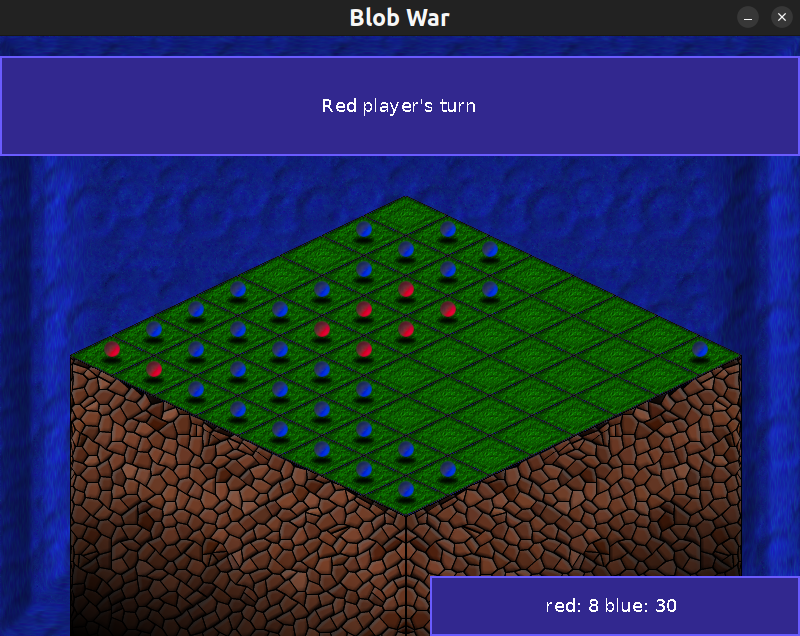

<div align="center">


A parallelized alpha-beta algorithm developed to play [BlobWar](#-blobwar-game).

</div>

## 🎓 School Project Information

|  |  |
|--|--|
| Team   | 1 |
| Course | Advanced Algorithms & Complexity |
| School | Grenoble INP - Ensimag |

## 👾 BlobWar Game

**BlobWar** is a two-player chessboard-game. On each turn, a player moves a blob either by duplicating it on an adjacent square, or jumping it two squares away without duplication. After a move, any opposing blobs on adjacent squares to the target square will change color.

<div align="center">



</div>

## 🛠️ How To Build

```
make

./blobwar
```

---

<div align="center">
  Copyright &#169; 2024 PyroWilDx. All Rights Reserved.
</div>
